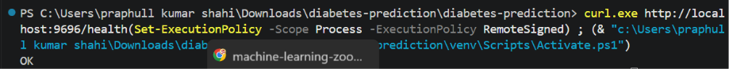
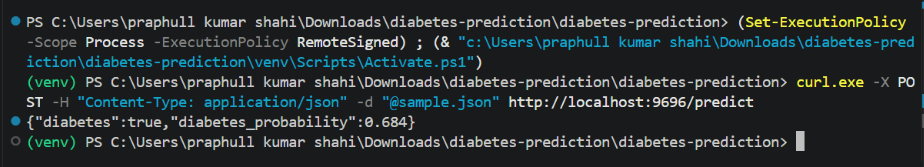

# Diabetes Prediction (ML Zoomcamp Midterm Project)

## 1. Problem description
Diabetes often goes undiagnosed for years. Early screening helps people start treatment sooner.
This project predicts **whether a patient is likely to have diabetes** from 8 simple medical measurements
(glucose, BMI, age, blood pressure, insulin, etc.).

**How it would be used:** a clinic, health app or screening camp sends a patient's measurements to the web
service and gets back a diabetes probability. Patients with a high probability are referred for a proper lab test.
It is a *screening aid*, not a diagnosis tool.

- Task: binary classification (`outcome`: 1 = diabetes, 0 = no diabetes)
- Main metric: **ROC AUC** (target is moderately imbalanced, ~65% / 35%)

## 2. Dataset
Pima Indians Diabetes dataset (768 rows, 8 features, 1 target).
- Already included: `data/diabetes.csv`
- Or download: `curl -o data/diabetes.csv https://raw.githubusercontent.com/jbrownlee/Datasets/master/pima-indians-diabetes.data.csv`
- Original source: UCI / Kaggle "Pima Indians Diabetes Database" (the file has no header; column names are added in code)

| Feature | Meaning |
|---|---|
| pregnancies | number of pregnancies |
| glucose | plasma glucose concentration |
| blood_pressure | diastolic blood pressure (mm Hg) |
| skin_thickness | triceps skin fold thickness (mm) |
| insulin | 2-hour serum insulin |
| bmi | body mass index |
| diabetes_pedigree | family-history score |
| age | age in years |

## 3. EDA summary (see `notebook.ipynb`)
- No NaNs in the raw file, but **zeros in glucose, blood pressure, skin thickness, insulin and BMI are impossible values**
  (they mean "not measured"). They are converted to missing and imputed with the median
  (insulin has ~49% missing, skin thickness ~30%).
- Target: ~65% no diabetes / ~35% diabetes.
- Feature importance (correlation + mutual information): **glucose** is the strongest feature, then BMI, age, pregnancies.

## 4. Modeling
Pipeline = median imputer, standard scaler, model. 80/20 stratified split, 5-fold CV with GridSearchCV.

| Model | CV AUC |
|---|---|
| Baseline decision tree (depth 3) | 0.759 |
| **Logistic Regression (C=0.1)** | **0.844** |
| Random Forest | 0.841 |
| Gradient Boosting | 0.830 |

Selected model: Logistic Regression, **test AUC ≈ 0.81**. Simple, fast and interpretable.

## 5. Project structure
```
├── README.md
├── data/diabetes.csv
├── notebook.ipynb     # cleaning, EDA, feature importance, model selection
├── train.py           # trains + tunes models, saves model.bin
├── predict.py         # Flask web service
├── model.bin          # saved model
├── sample.json        # example request body
├── screenshots/       # proof of working service and Docker
├── requirements.txt
└── Dockerfile
```
Architecture: `data → train.py → model.bin → predict.py (Flask/gunicorn) → /predict`

## 6. How to run locally
Requires Python 3.10+ (the Docker image uses Python 3.12).
```bash
git clone https://github.com/shahipraphullkr/ml-zoomcamp-midterm-project.git
cd ml-zoomcamp-midterm-project
python -m venv venv
source venv/bin/activate          # Windows: venv\Scripts\activate
pip install -r requirements.txt

python train.py                    # creates model.bin
python predict.py                  # starts service on http://localhost:9696
```
Notebook extra packages: `pip install jupyter matplotlib seaborn`, then `jupyter notebook notebook.ipynb`.

## 7. API usage
Health check: `curl http://localhost:9696/health`

Prediction (works on Linux, Mac and Windows):
```bash
curl -X POST -H "Content-Type: application/json" -d @sample.json http://localhost:9696/predict
```
Windows PowerShell alternative:
```powershell
curl.exe -X POST -H "Content-Type: application/json" -d "@sample.json" http://localhost:9696/predict
```
Response:
```json
{"diabetes": true, "diabetes_probability": 0.684}
```
Missing fields are allowed (they are imputed). Use `0` or omit a value if it was not measured.

## 8. Docker
```bash
docker build -t diabetes-prediction .
docker run -it --rm -p 9696:9696 diabetes-prediction
```
The image trains the model during the build, then serves it with gunicorn. Test with the same `curl` command.

## 9. Cloud deployment (not deployed)
The project was not deployed to the cloud. It can be deployed with the included Dockerfile, for example on Render:
1. Push this repo to GitHub.
2. On render.com: New → Web Service → connect this repo.
3. Runtime: Docker, instance type: Free, then Deploy.
4. Test:
```bash
curl https://<your-app>.onrender.com/health
curl -X POST -H "Content-Type: application/json" -d @sample.json https://<your-app>.onrender.com/predict
```

## 10. Limitations / next steps
- Small dataset (768 rows), all female patients of Pima heritage, so it may not generalize to other populations.
- Not a medical device; a doctor's diagnosis is required.
- Next: threshold tuning for higher recall, SHAP explanations, more data.

## Screenshots

Health check:
![Health check] 

Prediction:
![Prediction] 

Docker image built and service running:
![Docker running] 
